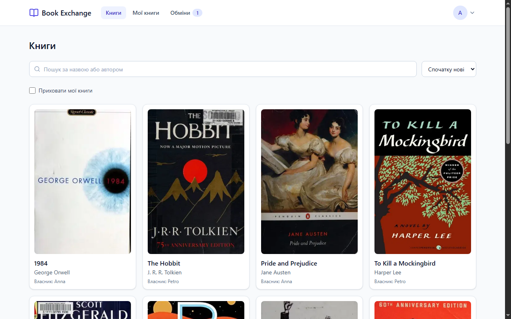
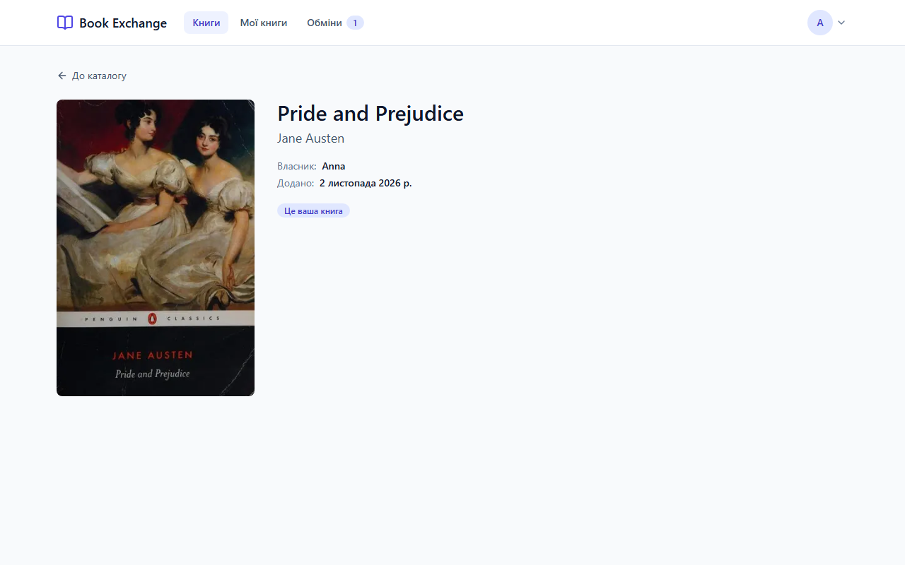
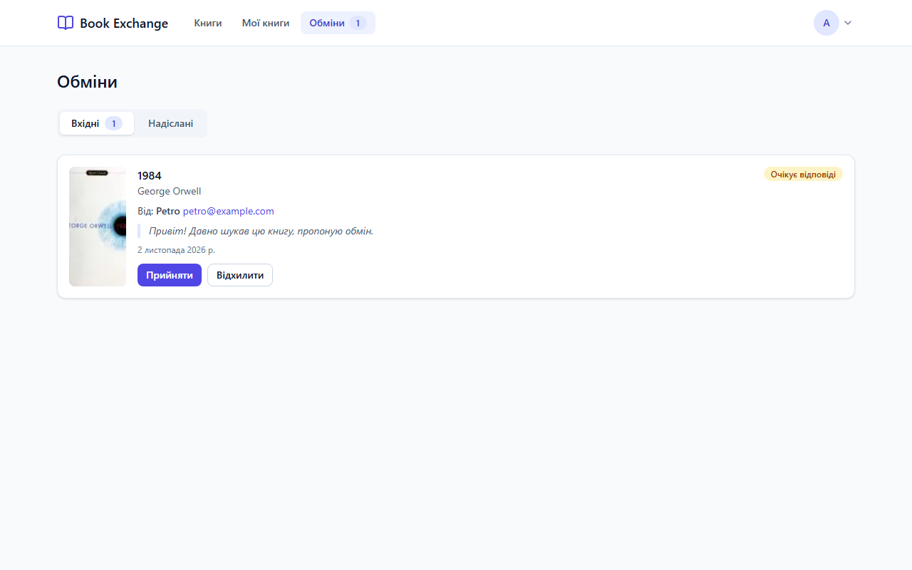
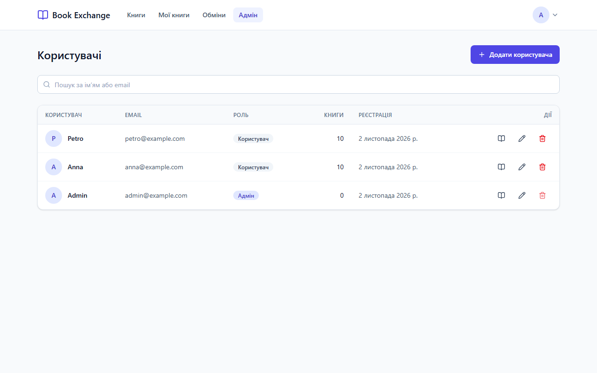

# Book Exchange

Веб-застосунок для обміну книгами. Користувачі додають власні книги, шукають книги інших,
переглядають деталі й надсилають запит на обмін. Запит зберігається в БД, а власник книги
отримує лист з іменем і email відправника та списком книг, які той пропонує. Є профіль,
відновлення пароля та адмін-панель для керування користувачами й книгами.

## Скріншоти

| Каталог                                | Сторінка книги                                       |
| -------------------------------------- | ---------------------------------------------------- |
|  |  |

| Обміни                                    | Адмін-панель                                |
| ----------------------------------------- | ------------------------------------------- |
|  |  |

## Стек

**Обовʼязковий:** Next.js (App Router) + TypeScript + Tailwind CSS; NestJS + TypeScript + Prisma + PostgreSQL.

**Додаткові бібліотеки та навіщо вони:**

| Бібліотека                                             | Навіщо                                                                           |
| ------------------------------------------------------ | -------------------------------------------------------------------------------- |
| `@nestjs/config` + `zod`                               | Валідація env на старті: застосунок падає з переліком проблемних змінних         |
| `@nestjs/passport`, `passport-jwt`, `@nestjs/jwt`      | Стандартна JWT-автентифікація для NestJS                                         |
| `bcrypt`                                               | Хешування паролів (10 раундів)                                                   |
| `class-validator` + `class-transformer`                | Валідація й нормалізація DTO (trim, lowercase email)                             |
| `@nestjs/swagger`                                      | Жива документація API на `/api/docs`                                             |
| `@nestjs/throttler`                                    | Обмеження частоти запитів на логін, скидання пароля й запити обміну              |
| `helmet`                                               | Безпечні HTTP-заголовки                                                          |
| `@nestjs-modules/mailer` + `nodemailer` + `handlebars` | Листи за HTML-шаблонами                                                          |
| `multer` + `@nestjs/serve-static`                      | Завантаження обкладинок і аватарів та їх роздача                                 |
| `@tanstack/react-query`                                | Кеш серверних даних, інвалідація після мутацій, `keepPreviousData` для пагінації |
| `zustand` (persist)                                    | Мінімальний стор сесії без шаблонного коду                                       |
| `react-hook-form` + `zod` + `@hookform/resolvers`      | Форми з типобезпечною валідацією                                                 |
| `axios`                                                | Єдиний клієнт з інтерсепторами (Bearer, обробка 401)                             |
| `sonner`                                               | Тости без налаштувань                                                            |
| `lucide-react`                                         | Консистентний набір іконок                                                       |
| `clsx` + `tailwind-merge`                              | Умовні класи Tailwind без конфліктів                                             |
| `use-debounce`                                         | Debounce пошуку (400 мс)                                                         |
| `jest`, `supertest`, `ts-jest`                         | Unit- та e2e-тести API                                                           |
| `pnpm` workspaces                                      | Монорепо з пакетом спільних типів                                                |
| Docker Compose (`postgres:16`, `axllent/mailpit`)      | Локальна БД і перехоплення листів                                                |

Власних UI-кітів немає: усі компоненти написані на Tailwind. Redux і MUI не використовуються.

## Швидкий старт

Потрібні Node.js 20+, pnpm і Docker.

```bash
cp apps/api/.env.example apps/api/.env
cp apps/web/.env.example apps/web/.env.local

docker compose up -d
pnpm i
pnpm db:migrate
pnpm db:seed
pnpm dev
```

Тести: `pnpm lint`, `pnpm typecheck`, `pnpm test` (Jest + Supertest для API, Vitest для чистих функцій і схем у web). Повний e2e-сценарій на реальній БД запускається,
коли задано `E2E_DATABASE_URL` (наприклад, ту саму БД, що й у `.env`, після `pnpm db:migrate`);
без неї цей набір пропускається, решта e2e працюють без БД.

## Адреси

| Що              | Адреса                         |
| --------------- | ------------------------------ |
| Web             | http://localhost:3000          |
| API             | http://localhost:4000/api      |
| Swagger         | http://localhost:4000/api/docs |
| Mailpit (листи) | http://localhost:8025          |

## Тестові акаунти (після `pnpm db:seed`)

| Email               | Пароль      | Роль  |
| ------------------- | ----------- | ----- |
| `admin@example.com` | `Admin123!` | ADMIN |
| `anna@example.com`  | `User123!`  | USER  |
| `petro@example.com` | `User123!`  | USER  |

Seed створює також 20 книг з обкладинками (openlibrary), розподілених між Anna та Petro.

## Архітектура

```
book-exchange/
├─ apps/
│  ├─ api/                    NestJS
│  │  ├─ prisma/              schema.prisma, migrations, seed.ts
│  │  ├─ src/
│  │  │  ├─ auth/             register, login, me, скидання пароля
│  │  │  ├─ users/            профіль, адмін-керування користувачами
│  │  │  ├─ books/            каталог, мої книги, модерація
│  │  │  ├─ exchange-requests/ запити на обмін та їх статуси
│  │  │  ├─ mail/             MailService + шаблони *.hbs
│  │  │  ├─ uploads/          StorageService, multer, роздача /uploads
│  │  │  ├─ common/           guards, decorators, filters, pagination
│  │  │  ├─ config/           zod-схема env
│  │  │  └─ prisma/           PrismaModule (global)
│  │  └─ test/                e2e (Supertest)
│  └─ web/                    Next.js
│     └─ src/
│        ├─ app/              сторінки лише компонують features/
│        ├─ features/         auth, books, exchange, profile, admin
│        │                    (api.ts, hooks.ts, schemas.ts, components/)
│        ├─ components/       ui/ (власні компоненти) та layout/
│        ├─ lib/              api-client, query-client, утиліти
│        ├─ stores/           auth.store.ts
│        └─ middleware.ts     захист маршрутів за cookie
├─ packages/shared/           Role, ExchangeStatus, Paginated<T>, типи відповідей
├─ docker-compose.yml         postgres:16 + mailpit
└─ .github/workflows/ci.yml   install, lint, typecheck, test, build
```

Правила: controller відповідає лише за HTTP, логіка живе в service, валідація в DTO, доступ до БД
через `PrismaService`; сторінки в `app/` тільки збирають компоненти з `features/`.

## Ключові рішення

- **Один спільний пакет типів.** `packages/shared` гарантує, що API й web домовляються про ролі,
  статуси та форму відповідей.
- **Безпека відповідей.** `passwordHash` ніколи не потрапляє у відповідь: користувачі завжди
  читаються через явний `select` (`PUBLIC_USER_SELECT`), e2e-тест перевіряє це по всьому сценарію.
- **Контакти власника.** Email власника книги відправник бачить лише після того, як запит прийнято;
  власник одразу бачить контакти відправника (він і так приходить йому в листі).
- **Права доступу.** Усі маршрути закриті глобальним `JwtAuthGuard`, відкриті лише каталог, реєстрація,
  логін і відновлення пароля (`@Public()`). Адмін-маршрути мають `@Roles(ADMIN)`, адмін не може
  видалити себе чи позбавити себе ролі.
- **Гонки.** Відповідь на запит обміну виконується умовним оновленням (`status = PENDING`), тому
  два одночасні accept/cancel не пройдуть обидва.
- **Rate limit.** Логін (5/хв), реєстрація (10/хв), скидання пароля (5/хв), зміна пароля (5/хв),
  створення запитів обміну (10/хв). Логін для невідомого email теж виконує bcrypt, щоб час відповіді
  не розкривав, чи існує акаунт.
- **Скидання пароля.** Токен випадковий (`randomBytes(32)`), у БД лише SHA-256, діє 30 хвилин,
  одноразовий (умовне оновлення в транзакції), відповідь завжди 204 незалежно від існування email.
- **Роль перевіряється на сервері.** `RoleGate` у вебі лише показує 403-стан, а `RolesGuard`
  захищає API; роль береться з БД на кожен запит, тож стара роль у токені нічого не дає.
- **400 замість 401 для невірного поточного пароля.** Клієнт трактує будь-який 401 як завершену
  сесію й розлогінює.
- **Помилка пошти не ламає відповідь.** Запит обміну вже збережений, тому збій SMTP лише логується.
- **Файли.** Уся робота з ними йде через `StorageService` (легко замінити на S3); при видаленні
  книги чи користувача й при заміні обкладинки старі файли прибираються.
- **Сортування за алфавітом** доступне і за назвою (А→Я, Я→А), і за автором.
- **Стан у URL.** Пошук, сортування, сторінка й «Приховати мої книги» живуть в query, тому
  посилання відтворюють вигляд сторінки.
- **Модалки на нативному `<dialog>`.** Фокус-пастка, Esc і повернення фокусу працюють без бібліотек.

## Зроблено понад ТЗ

- Адмін-модерація: перегляд книг користувача й видалення окремих книг.
- Параметр `excludeOwnerId` у каталозі для коректної пагінації з прихованими власними книгами.
- Профіль з аватаром, лічильниками та зміною пароля; відновлення пароля.
- Безпечний `?redirect=` (лише внутрішні шляхи), нормалізація email, ліміти довжин (bcrypt 72 байти).
- Throttling на логін, скидання пароля й створення запитів; helmet; CORS лише для `WEB_URL`.
- Скелетони, порожні стани й стани помилок скрізь, `error.tsx` і `not-found.tsx`.
- Unit-тести сервісів, e2e на guards і повний сценарій на реальній БД, CI з Postgres.

## Відомі обмеження

- JWT не відкликається після зміни або скидання пароля (потрібні refresh-токени або `tokenVersion`).
- Унікальність PENDING-запиту на книгу перевіряється в коді; жорстка гарантія вимагає partial unique
  index (Prisma його не описує, потрібна ручна міграція).
- Тип завантаженого файлу перевіряється за заголовком клієнта, а не за вмістом (magic bytes).
- Swagger не має схем відповідей для більшості ендпоінтів, лише для auth.
- Next.js за замовчуванням не оптимізує зображення з локальних адрес, тому в `next.config.ts`
  `dangerouslyAllowLocalIP` вмикається лише коли `NEXT_PUBLIC_API_URL` вказує на localhost.

## Що покращити далі

- **S3 або сумісне сховище** замість локального диска: достатньо нової реалізації `StorageService`.
- **Refresh-токени в httpOnly-cookie.** Зараз токен лежить у localStorage й звичайному cookie для
  middleware, що вразливіше до XSS; короткоживучий access-токен + refresh у httpOnly закриє це.
- **`pg_trgm` + GIN-індекс** для швидкого нечіткого пошуку по назві й автору замість `ILIKE`.
- **WebSocket-сповіщення**, щоб бейдж запитів і статуси оновлювалися без перезавантаження.
- Бейдж запитів у шапці зараз рахується з повного списку вхідних; варто взяти готовий `pendingIncomingCount` з `GET /users/me`.
- Можливість прибрати обкладинку при редагуванні книги та адаптивні картки замість таблиці в адмінці.
- Перейменування `middleware.ts` на `proxy.ts`, як рекомендує Next.js 16.
